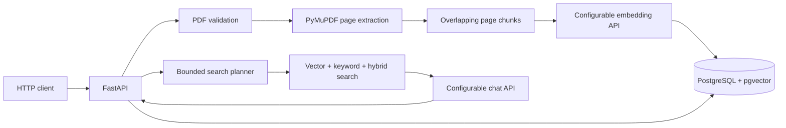

# Enterprise AI Knowledge Agent

A portfolio project for answering questions over company PDFs with evidence and verifiable citations. The backend accepts text-based PDFs, preserves page references, generates embeddings through a configurable provider, combines pgvector and PostgreSQL full-text search, and returns citation-checked answers. A bounded search planner can reformulate a query and use at most two additional searches. A React interface supports uploads, document status, chat, abstentions, and source citations. Authentication and production multi-user support remain out of scope.

## Current architecture



The upload request is processed synchronously in this stage. A new document is saved as `processed` or `failed` when the request completes; retrying a previously failed document persists its `processing` status while it is retried. This does not provide live processing updates; the frontend reports transfer progress while the file uploads, and a background job is a later enhancement.

## Local setup

Requirements: Python 3.11+, Node.js 22.12+, npm, Docker Desktop with Compose, and PowerShell (commands below).

From the project root:

```powershell
Copy-Item .env.example .env
docker compose up -d db
Set-Location backend
py -3.11 -m venv .venv
.\.venv\Scripts\Activate.ps1
python -m pip install -e ".[dev]"
alembic upgrade head
python -m uvicorn app.main:app --reload
```

The database port is bound to localhost. Change the local placeholder database password in `.env` before using this beyond local development. Keep `.env` private; it is ignored by Git.

Health endpoints:

- `GET http://127.0.0.1:8000/health/live`
- `GET http://127.0.0.1:8000/health/ready`

Document endpoints:

- `POST /documents` with multipart field `file` containing an `application/pdf` upload
- `GET /documents`
- `GET /documents/{document_id}`
- `DELETE /documents/{document_id}`

The upload limit, chunk size, and overlap are configured with `MAX_UPLOAD_BYTES`, `CHUNK_SIZE_CHARS`, and `CHUNK_OVERLAP_CHARS` in `.env`. Duplicate PDF content returns HTTP 409. Uploads with an acceptable PDF signature but unsupported or unextractable content return HTTP 422 and are recorded as failed; uploads that fail earlier validation are rejected without a document row. The current text extraction does not perform OCR, so image-only/scanned PDFs are unsupported.

Embedding and chat use separate OpenAI-compatible API base URLs and model settings. Point `EMBEDDING_API_BASE_URL` and `LLM_API_BASE_URL` to services exposing `/embeddings` and `/chat/completions`; set API keys only in `.env` when required. Local inference servers can be used if they provide this API shape. Upload and chat return HTTP 503 until their respective provider settings are configured. No provider is contacted during migrations or tests.

The vector column dimension defaults to 1536. Choose an embedding model that emits this size before applying migrations. Changing dimensions on an existing database requires a migration and regenerating all document embeddings. `POST /chat` accepts `{"question": "..."}` and returns an answer, abstention/conflict flags, citations with document name, page, source chunk ID, and the model-quoted passage, plus the retrieved source list and request metrics. The backend rejects citations whose chunk or quote does not match retrieved evidence. This checks citation provenance; it cannot guarantee that every generated claim is entailed by its citation.

Retrieval uses cosine similarity, PostgreSQL English full-text search, and reciprocal-rank fusion for hybrid searches. The agent starts with vector search, can use only `vector`, `keyword`, `hybrid`, or `finish`, stops on repeated plans, and is limited to at most two additional searches. Retrieved passages are treated as untrusted data in both planner and answer prompts. Document contents and questions are not written to application logs. HTTP logs include request ID, method, path, status, and latency. Chat metrics include latency, search count, LLM calls, and provider-reported token counts when available. Estimated LLM cost is emitted only when usage is reported and both model-specific input/output rates are configured; embedding cost is not included.

Documents ingested before embedding was configured can be backfilled after applying migrations and configuring the embedding endpoint:

```powershell
python -m app.reembed
```

## Evaluation

The checked-in evaluation questions and expected source pages live in `evaluation/`. With the backend running, migrations applied, and embedding/chat providers configured, seed the small reference PDF corpus and run the evaluation from `backend`:

```powershell
python -m app.evaluation.seed
python -m app.evaluation.runner
```

Seeding uploads three synthetic PDFs and does not delete them. The runner reports measured retrieval recall, answer-term correctness, citation precision/recall, abstention and conflict accuracy, latency, reported LLM tokens, and configured LLM cost estimates. It makes live embedding/chat requests, so provider usage may incur cost. No measured result is included in this repository until the evaluation is run.

## Migrations and tests

Run from `backend`:

```powershell
alembic upgrade head
python -m pytest
```

No test results are claimed in this environment: Python and Docker were unavailable when this stage was implemented.

## Frontend

From a second terminal at the project root:

```powershell
Set-Location frontend
Copy-Item .env.example .env
npm install
npm run dev
```

The Vite development server runs at `http://127.0.0.1:5173` and proxies `/api` requests to FastAPI at `http://127.0.0.1:8000`. Start the backend first. `VITE_MAX_UPLOAD_BYTES` controls browser-side size validation and should match `MAX_UPLOAD_BYTES` in the root `.env`.

Run the frontend checks from `frontend`:

```powershell
npm test
npm run build
```

The dependency install could not be completed in the current environment because npm was configured to use only its local cache, which did not contain these packages. The frontend build and tests are therefore unverified here.

## Deployment guidance

The checked-in Compose file is for local development and starts PostgreSQL only. It is not a production deployment. Before deploying, build and run the API and frontend as separate services, use a managed PostgreSQL instance with pgvector (or operate PostgreSQL with an explicit backup and recovery plan), and configure the frontend to call the deployed API over HTTPS. The current Vite `/api` proxy is a development-server setting and is not a production API proxy.

For any hosting platform:

1. Create a PostgreSQL database with the pgvector extension available and restrict network access to the API service.
2. Configure `DATABASE_URL`, provider URLs, model names, and API keys through the platform's secret environment-variable store. Do not copy `.env` into an image or repository.
3. Set `EMBEDDING_DIMENSIONS` to the selected model's output size before running `alembic upgrade head`. Changing dimensions later requires a database migration and re-embedding stored chunks.
4. Build the backend from `backend/` using its `pyproject.toml`; run migrations as a release step, then start `uvicorn app.main:app --host 0.0.0.0 --port $PORT` from that directory. Configure the platform health check to use `/health/ready`.
5. Build the frontend from `frontend/` with `npm run build` and host the generated `dist/` directory as a static site. Configure a same-origin `/api` reverse proxy to the API, or change `API_ROOT` in `frontend/src/api.ts` to the HTTPS API origin and add API CORS middleware with an explicit origin allowlist; CORS is not configured in this repository.
6. Enable TLS, backups, log retention limits, and monitoring for the database and API. Set upload limits to fit the hosting platform's request limits.

This repository does not include production container images, a platform-specific deployment manifest, authentication, tenant isolation, or authorization. Add authentication and document-level access checks before exposing company documents to multiple users. Confirm hosting and model-provider costs with the selected vendors; this project has no deployment target or measured production capacity configured.

## Current limitations

- Local single-tenant development only; authentication and document-level authorization are required before multi-user use.
- PDF extraction, embedding, and chunk persistence run synchronously within the upload request.
- Reranking, asynchronous ingestion, multi-user authorization, embedding token/cost reporting, and production deployment configuration are not implemented yet.
- No OCR is provided for scanned PDFs.
